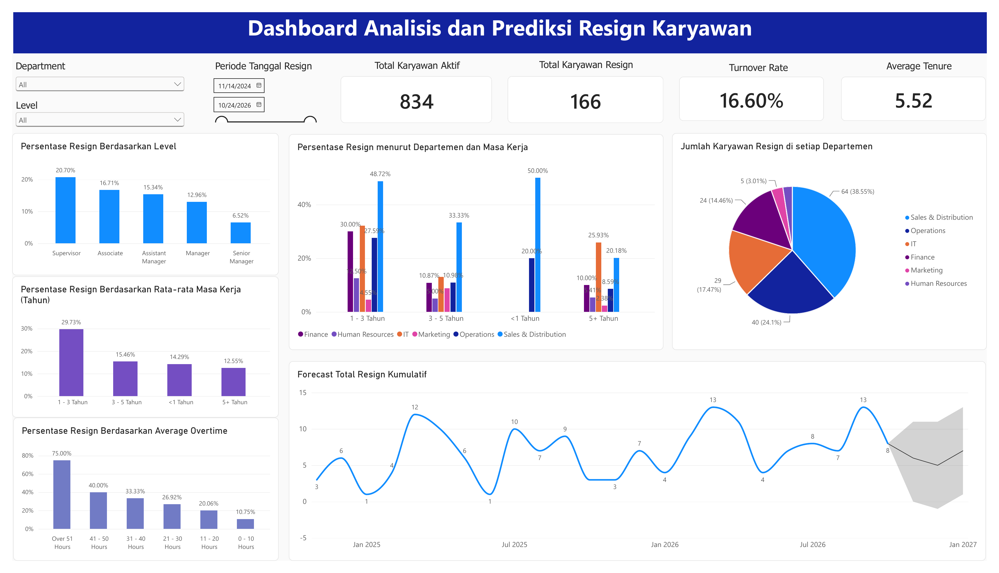
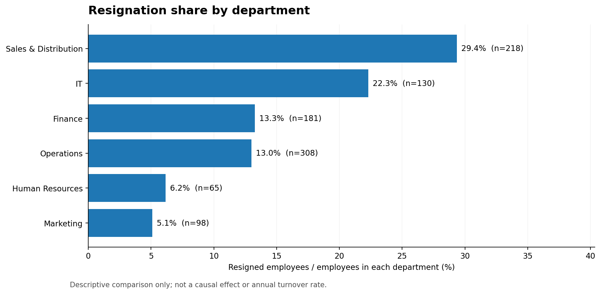
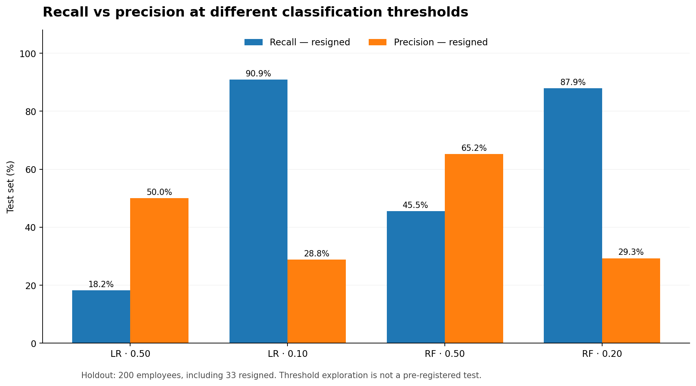
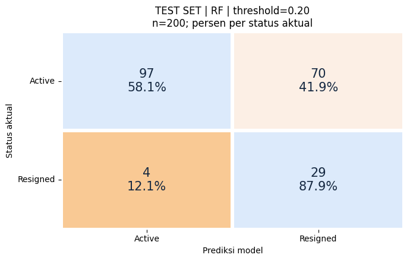

# Employee Attrition Prediction & HR Analytics

**Machine Learning · People Analytics · Power BI**



An end-to-end HR analytics case study combining an exploratory Power BI dashboard with supervised classification models to **identify resignation-related patterns** and study the operational trade-off between detecting likely resignations and raising false alarms.

> **Portfolio highlight:** On a 200-employee holdout set (33 resigned), Logistic Regression at a **0.10 illustrative threshold** identified **30 of 33** resignations (90.9% recall), versus **6 of 33** (18.2%) at a 0.50 threshold. This increased false positives from **6 to 74**. Thresholds were explored during analysis, so these test-set results should not be treated as an unbiased estimate for a pre-selected final policy.

## Project snapshot

| Area | Details |
| --- | --- |
| Data | 1,000 employee records: 834 active, 166 resigned |
| Modeling | Logistic Regression and Random Forest |
| Features | Department, level, age, tenure, salary ratio, performance, months since promotion, overtime, engagement |
| Preparation | StandardScaler for numeric columns, OneHotEncoder for categorical columns |
| Validation | Stratified 80/20 train–test split; 5-fold stratified cross-validation on training data |
| Metrics | Precision, recall, F1, **F2**, ROC AUC, average precision, confusion matrix |
| Analytics | Attrition patterns by department, seniority, tenure, and overtime; interactive Power BI report |

## Business questions

1. Which employee segments show higher resignation shares?
2. How are tenure, overtime, compensation and engagement related to the observed resignations?
3. How well can different classifiers flag potentially resigning employees?
4. What is the operational cost of prioritizing recall instead of overall accuracy?

## Descriptive findings

The following results are associations in the supplied case data; they **do not prove why someone resigned**.

| Finding | Evidence | Practical follow-up |
| --- | --- | --- |
| Early tenure deserves attention | 29.73% resignation share in the 1–3 year group, versus 12.55% at 5+ years (as summarized in the analysis notebook) | Investigate onboarding and early-career support through employee/exit interviews |
| Supervisors have elevated attrition share | 20.70% among supervisors vs 6.52% among senior managers | Evaluate workload and role expectations by level |
| Overtime is associated with resignation | The notebook finds ~10.75% in the 0–10 hour group vs ~33.33% in the 31–40 hour group; Pearson correlation ≈ +0.22 | Review workload distribution; do not infer causality |
| Sales & Distribution accounts for the largest resignation count | 64 of 166 resigned employees (38.55% of resignations); 29.36% within-department resignation share | Prioritize deeper qualitative investigation; distinguish count from rate |



## Machine learning workflow

1. **Inspect the case dataset** and examine numeric correlations with the resignation target (`Active` = 0, `Resigned` = 1).
2. **Select nine predictors** while excluding the employee ID, target label, and resignation date from predictors.
3. **Stratify the 80/20 split**: 800 training records (133 resigned) and 200 holdout records (33 resigned).
4. **Preprocess** numeric and categorical variables, with the transformations fit on training data. The 5-fold CV function uses a fresh preprocessing pipeline inside each fold to avoid preprocessing leakage across validation folds.
5. **Train and compare** Logistic Regression and Random Forest.
6. **Examine thresholds** and compare precision/recall, confusion matrices and F2 score, placing greater emphasis on detecting resignations.

### Test-set results (n = 200)

| Model | Threshold | Accuracy | Resigned precision | Resigned recall | F2 | True positives | False positives |
| --- | ---: | ---: | ---: | ---: | ---: | ---: | ---: |
| Logistic Regression | 0.50 | 83.5% | 50.0% | 18.2% | 0.208 | 6 | 6 |
| Logistic Regression | 0.10 | 61.5% | 28.8% | **90.9%** | **0.636** | 30 | 74 |
| Random Forest | 0.50 | **87.0%** | **65.2%** | 45.5% | 0.484 | 15 | 8 |
| Random Forest | 0.20 | 63.0% | 29.3% | 87.9% | 0.628 | 29 | 70 |

All four test scenarios are calculated from the **same holdout set**. ROC AUC was 0.829 for Logistic Regression and 0.825 for Random Forest; changing a decision threshold does not change a model's ROC AUC.



**Business interpretation:** A lower threshold catches more potential resignations but creates more false-positive cases to investigate. With limited HR outreach capacity, threshold selection should account for intervention cost, review capacity, the relative cost of missed resignations, and validation results—not just maximize recall.

**Methodological limitation:** The notebook presents exploratory threshold choices and their holdout scores. Since these choices were examined alongside test-set performance, they are **not** an unbiased final threshold-selection experiment. A stronger next iteration would choose a threshold using *only out-of-fold training predictions*, lock it, and then perform one final holdout evaluation. Probabilities are also not demonstrated to be calibrated.

### Example evaluation visuals

| Logistic Regression — threshold 0.10 | Random Forest — threshold 0.20 |
| --- | --- |
|  |  |

## Power BI dashboard


The report is available in [`dashboard/employee_attrition_dashboard.pbix`](dashboard/employee_attrition_dashboard.pbix). The screenshot above is from the project's actual Power BI report, supplied by the author. The dashboard includes employee and attrition KPI cards (**834 active, 166 resigned, 16.60% resignation share**), department and level filters, attrition breakdowns by seniority and tenure, overtime comparisons, resignation counts by department, and a **time-series forecast visualization**. The dashboard's time-series forecast should not be confused with the employee-level classification models evaluated in the notebook.

Open the `.pbix` file using **Microsoft Power BI Desktop**. Some data source connections may need adjustment on another computer.

## Repository structure

```text
employee-attrition-prediction/
├── README.md
├── DATA_NOTICE.md
├── requirements.txt
├── .gitignore
├── data/
│   └── Case.xlsx
├── notebooks/
│   └── employee_attrition_analysis.ipynb
├── dashboard/
│   └── employee_attrition_dashboard.pbix
├── assets/
│   ├── power_bi_dashboard.png
│   ├── attrition_by_department.png
│   ├── model_precision_recall_tradeoff.png
│   ├── correlation_heatmap.png
│   ├── logistic_regression_roc.png
│   ├── logistic_regression_recall_threshold.png
│   └── random_forest_recall_threshold.png
└── results/
    ├── attrition_by_department.csv
    └── test_set_model_performance.csv
```

## Reproduce the analysis

1. Clone or download the repository and open a terminal in the **repository root**.
2. Create and activate a Python virtual environment, then install dependencies:
   ```bash
   python -m venv .venv
   # Windows: .venv\Scripts\activate
   # macOS/Linux: source .venv/bin/activate
   pip install -r requirements.txt
   ```
3. Launch Jupyter and run `notebooks/employee_attrition_analysis.ipynb` top to bottom. The notebook automatically looks for `data/Case.xlsx` from the repository root or its parent directory, and also supports `/content/Case.xlsx` in Google Colab.
4. Optionally open the Power BI source file in Power BI Desktop for interactive exploration.

The notebook retains its original executed figures and outputs for browsing on GitHub. The model tables and figures in this README reflect those outputs, not independently rerun benchmarks.

## Possible extensions

- Select a decision threshold on out-of-fold training predictions and evaluate it once on an untouched holdout set.
- Add probability calibration and precision–recall / intervention-capacity analysis.
- Test model stability across employee groups; perform a fairness and privacy review before any real-world HR application.
- Integrate model predictions into the dashboard, after appropriate privacy review.

## Data use & limitations

The original source and redistribution permissions for the case-study input are not established. **Read [`DATA_NOTICE.md`](DATA_NOTICE.md) and confirm permission to make the workbook and embedded Power BI model public.** The data represents a case study; the project is for portfolio/educational demonstration and not automatic employment decision-making.
